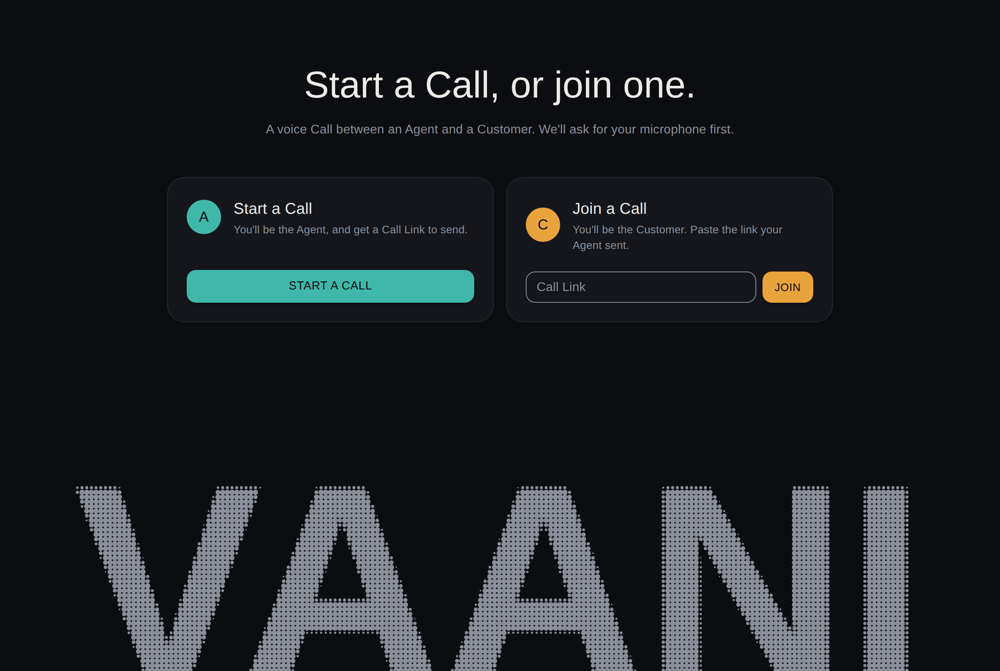
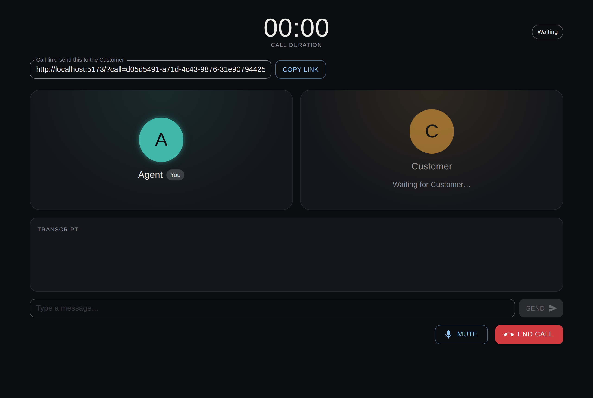
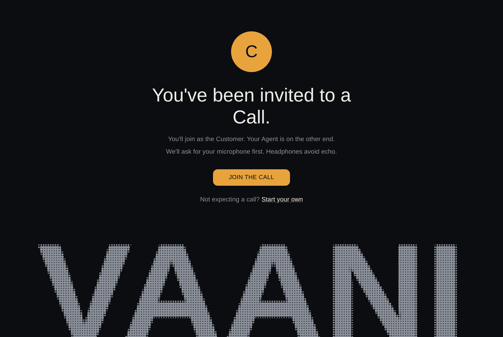
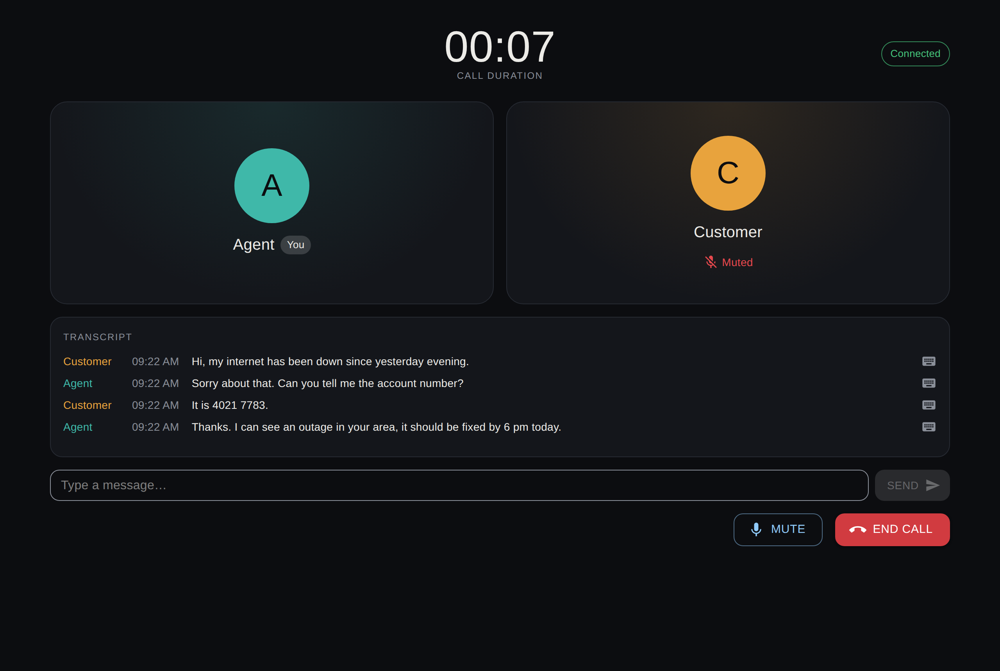
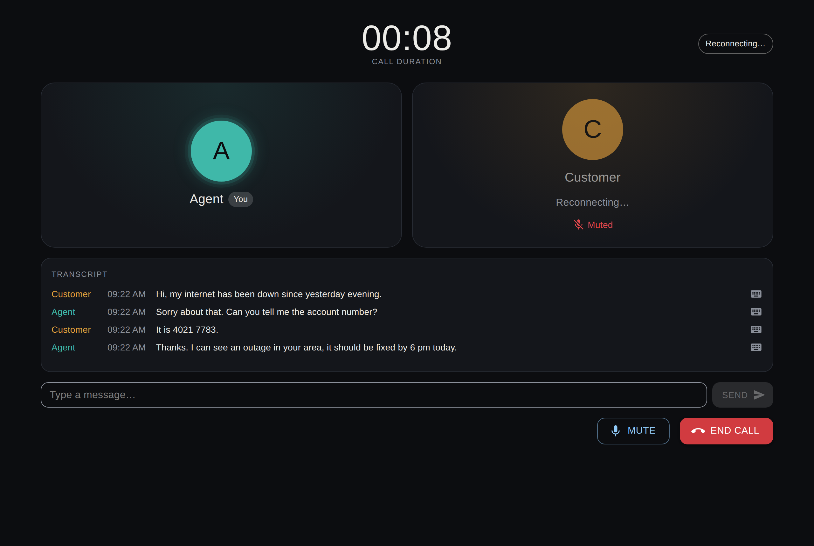
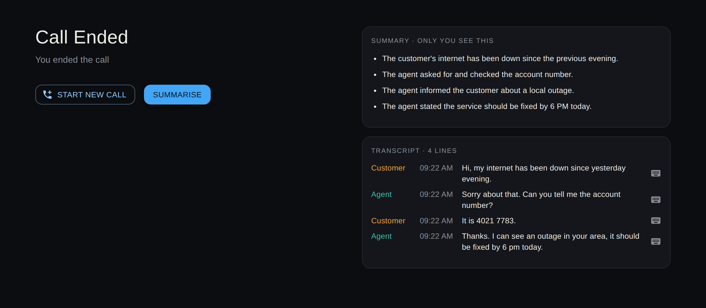

<br />
<p align="center">
  
</p>
<p align="center">
  Browser voice calls between a support Agent and a Customer, with a shared chat, live subtitles and a summary at the end.
</p>
<p align="center">
  <a href="#about-the-project">About</a> •
  <a href="#features">Features</a> •
  <a href="#getting-started">Getting started</a> •
  <a href="#how-it-works">How it works</a> •
  <a href="#problems-i-ran-into">Problems I ran into</a> •
  <a href="#screenshots">Screenshots</a> •
  <a href="#deploy">Deploy</a>
</p>

<p align="center">
  
</p>

## About the project

The Agent clicks Start a Call and sends the Customer the Call Link. When the Customer opens it, the two talk over WebRTC. Everything either of them types or says goes into one Transcript, and each side sees live subtitles of the other. When the Call ends, either side can ask Gemini for a short summary.

Call audio goes straight from one browser to the other and never passes through the Node server. The server relays the WebRTC handshake and the chat, and receives a separate copy of each mic so it can be transcribed for subtitles.

## Features

- Start a Call and you get a Call Link with a Copy button. Whoever opens it sees a single Join the Call button. The server hosts up to 20 Calls at once, kept apart from each other.
- Two Seats per Call, Customer and Agent. Anyone who opens a link whose Seat is already taken, including a second tab, gets an error, and the Call carries on.
- A Call is always Waiting, Connecting, Connected, Audio Failed, Reconnecting or Call Ended. Both sides see the same Call Duration, counted on the server's clock.
- Muting stops your audio and your subtitles, and the other side sees a Muted label on your tile.
- Typed Messages and spoken sentences (Utterances) land in one Transcript with who said what and when, on both sides at the same time.
- Live subtitles in English (India), through Sarvam's realtime speech-to-text, with the browser's own speech recognition as a fallback.
- A refresh or a short network drop doesn't end the Call. Your Seat is held for 15 seconds (the Grace Period) while the other side sees Reconnecting, and you come back to the same Seat and the Transcript so far.
- When the browsers can't reach each other, the Call shows Audio Failed with a Retry audio button, and chat and subtitles keep working.
- The Call Ended screen shows the reason (you ended it, they ended it, they lost connection, and so on), the full Transcript and a Summarise button. Only the person who pressed it sees the summary.

## Getting started

You need Node 20.6 or newer, since the server reads its `.env` with `node --env-file`. Subtitles need Chrome or Edge.

The repo has two separate npm projects, `server/` and `client/`. Set up each one in its own terminal.

### Server

```bash
cd server
npm install
```

Create `server/.env`:

```
SARVAM_API_KEY=your-sarvam-key
GEMINI_API_KEY=your-gemini-key
```

Both keys are optional. Without the Sarvam key, subtitles use the browser's speech recognition. Without the Gemini key, Summarise shows an error and everything else still works.

```bash
npm run dev        # http://localhost:3001
```

### Client

```bash
cd client
npm install
```

Create `client/.env`:

```
VITE_SERVER_URL=http://localhost:3001
```

```bash
npm run dev        # http://localhost:5173
```

### Try a Call

Open http://localhost:5173 in one tab and click Start a Call. Copy the Call Link, open it in a second tab, and click Join the Call. Both tabs share your mic, so use headphones and mute whichever tab isn't talking, or your words will show up as subtitles on both sides.

### Tests

```bash
(cd server && npm test)     # Node's built-in test runner
(cd client && npm run lint)
```

The server tests cover Seats and joining, the Grace Period timer (with `mock.timers`, so nothing actually waits), payload validation, the Transcript cap, the Sarvam stream, the Summary request and the rate limits.

## How it works

| Part | Built with |
|---|---|
| Client | React 19, Vite, MUI, socket.io-client |
| Server | Node, Express 5, Socket.io 4, `ws` for Sarvam |
| Voice | WebRTC, with Google's public STUN server |
| Subtitles | Sarvam realtime STT, Web Speech API as fallback |
| Summary | Google Gemini (`gemini-3.5-flash-lite`) |

The server keeps every live Call in memory: its two Seats, the Grace Period timers, when the Call started, and the last 200 Transcript entries. A Call is deleted once both Seats are empty.

When the second Participant joins, the one who was already waiting creates the WebRTC offer. The server passes the offer, answer and ICE candidates through without reading them, and the audio then flows browser to browser.

For subtitles, each browser runs an AudioWorklet that turns its mic into 16 kHz PCM and sends about 10 chunks a second to the server. The server forwards them to that Participant's own Sarvam websocket. Partial text goes only to the other side, as their live subtitle. A final sentence becomes an Utterance and is added to the Transcript for both sides. The Sarvam key stays on the server.

The Call Link is `/?call=<id>`, where the id comes from `crypto.randomUUID()`. A query string means the client needs no router and the static host needs no rewrite rules.

## Problems I ran into

### Choosing the subtitle language

I wanted subtitles that worked whichever of English, Hindi or Marathi the person spoke. The browser's Web Speech API takes one fixed language per session, so it can't detect which one is being spoken. I moved speech-to-text to Sarvam, which can detect the language itself, and routed it through the server so the API key never reaches the browser. That is the one time audio touches the server. Only a copy of the mic goes there for transcription; the call audio itself stays peer-to-peer.

I tested auto-detection with Sarvam text-to-speech clips fed into a fake mic in Chrome. It detected the language for each sentence and told Hindi and Marathi apart every time. The final sentences came out right. The live partial text, though, began in the previous sentence's script and corrected itself as the sentence went on, and English words inside a Hindi sentence came back in Devanagari. In the end I fixed the language to English (India) on both paths to keep the app simpler. Sarvam's auto mode is one URL parameter away if it's needed later.

Sarvam can also fail partway through a Call, for example when the credit runs out or the network drops. When that happens, the server marks that Participant as fallen back and tells their browser, and their browser switches to its own speech recognition within a fraction of a second. The other Participant isn't affected.

### Refreshing the page ended the Call

At first, any disconnect ended the Call for both sides, so a refresh killed it. Each tab now keeps a session id in `sessionStorage`, which survives a reload but isn't shared between tabs. When a socket drops, the server holds that Seat for 15 seconds. If the same session id comes back in that time, it gets the Seat back and the Transcript is replayed. The side that stayed makes a fresh WebRTC offer.

Two details made this work in practice:

- By default Socket.io takes around 45 seconds to notice a dead connection, which is longer than the Grace Period. I set `pingInterval` and `pingTimeout` to 5 seconds, so a dropped network is noticed in about 10.
- Sometimes the browser notices the drop and reconnects before the server has noticed. The server then has two sockets for the same Participant. If the old one disconnected later, it would start a Grace Period on a Seat that had just been taken back. Now, when a session rejoins, the server releases and disconnects its old socket first.

### From one Call to many

The first version hosted a single Call, and two tabs on the landing page each picked Customer or Agent. That only works if both people are using the same server, just for themselves. I changed it to Call Links. The random id in the link is the only access control, so the server never trusts a `callId` it didn't create. After you join, every later event uses the Call stored on your socket, never one named in the payload.

### Ordering details that are easy to get wrong

Two orderings in the server were set up deliberately. When a Call ends, the server sends `call-ended` to the Call's room before taking the sockets out of it; done the other way round, the room is already empty and the message reaches nobody. And when someone presses Retry audio, the server passes the retry only to the Participant who made the original offer. If both sides could restart ICE, two presses at once would send two offers that collide.

### Rate limits behind a proxy

Summaries cost Gemini credit and subtitles cost Sarvam credit, so both are rate limited. On Render the client's IP comes through a proxy and can't be trusted, so the Summary limit is one shared budget of 30 an hour. That's fine for a demo, but it means one person could use it all up. Sarvam audio is limited per socket to 1.5 times the normal chunk rate, and the server holds at most 20 live Calls.

## Screenshots

| | |
|---|---|
|  |  |
| The landing page. Start a Call makes you the Agent; pasting a link makes you the Customer. | The Agent waits for the Customer, with the Call Link ready to copy. |
|  |  |
| What the Customer sees on opening the link. | Connected. The Customer is Muted, and both sides share the Transcript. |
|  |  |
| The Customer dropped off. Their Seat is held for 15 seconds and the timer keeps going. | After the Call: the reason it ended, the Transcript, and the Summary. |

## Deploy

- The client is on Vercel. Import the repo, set Root Directory to `client/` (Vercel detects Vite), and set `VITE_SERVER_URL` to the Render server's `https://…onrender.com` URL. Vite reads it at build time, so redeploy after changing it.
- The server is on Render. Choose New > Blueprint and pick this repo, and `render.yaml` creates one free web service in `server/`. It asks for `CLIENT_ORIGIN` (the Vercel URL with no trailing slash), `SARVAM_API_KEY` and `GEMINI_API_KEY`. Render sets `PORT` itself.
- Run exactly one server instance. Live Calls are held in memory, so a second instance would split them.
- Render's free tier sleeps after about 15 minutes idle, so the first visit after that can take 30 seconds or more.

## Known limits

- There is no TURN server. On strict corporate or mobile networks the two browsers may not find a direct path, and the Call shows Audio Failed. Chat and subtitles still work. A TURN relay is what those networks would need.
- The browser fallback for subtitles only works in Chrome and Edge, and Chrome sends that audio to Google for recognition. In Firefox or Safari without Sarvam there are no subtitles.
- There are no accounts. Anyone who can reach the site can start a Call, and having the Call Link is the only way into one.
